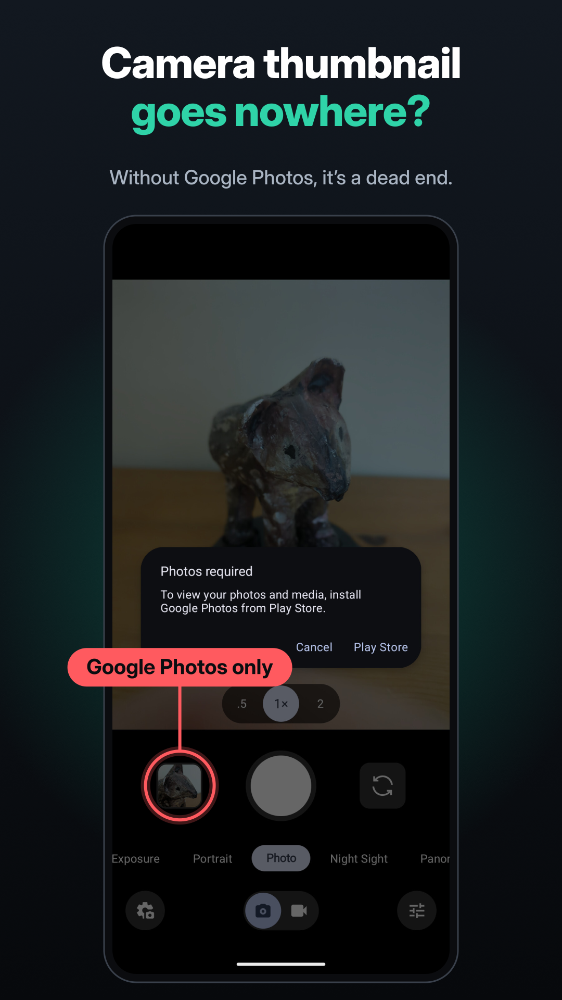
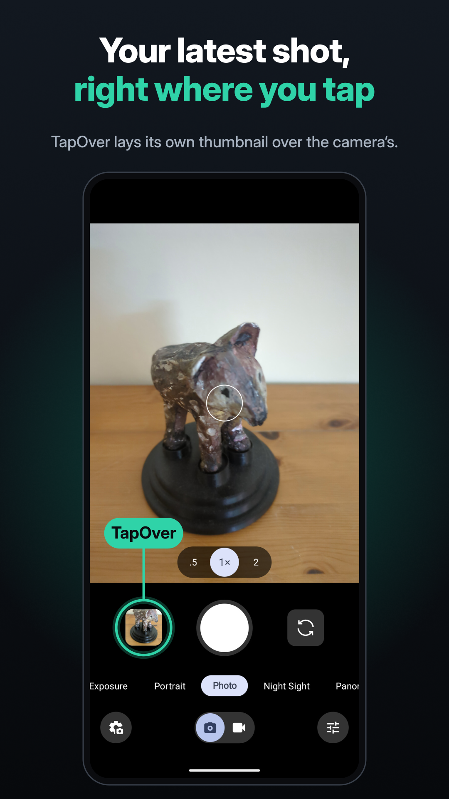
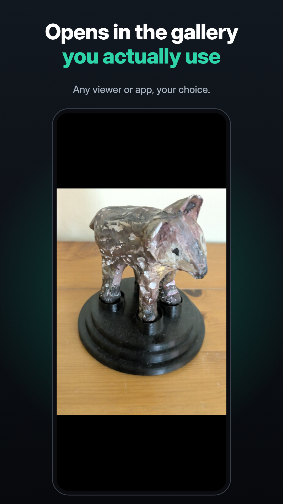
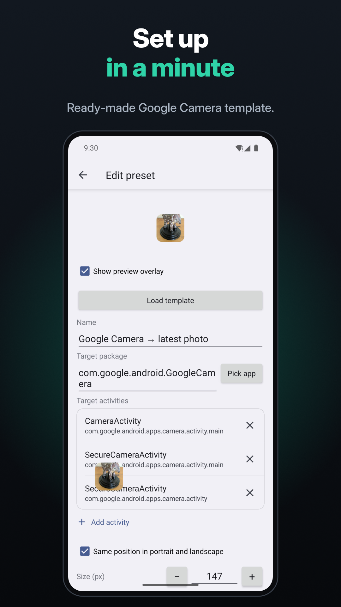
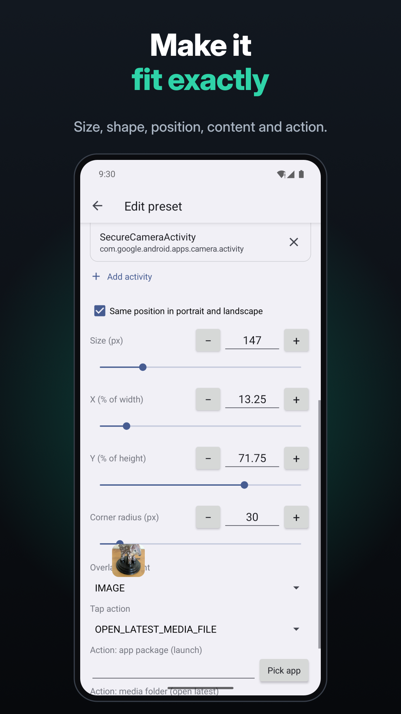
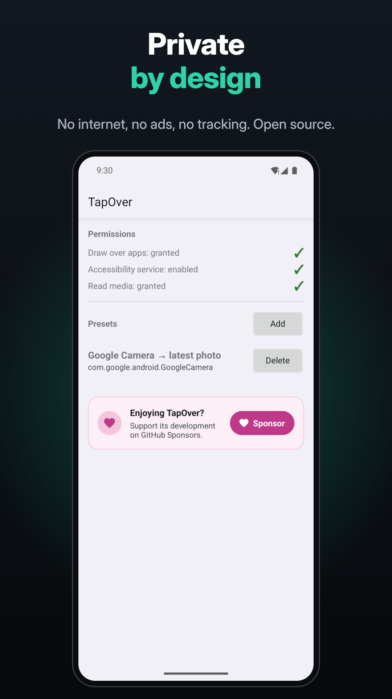
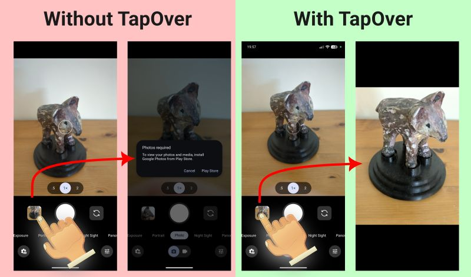

# TapOver

[](LICENSE)

[](https://github.com/sponsors/KopiasCsaba)

**Put a tap target on top of any Android app, and decide what happens when you tap it.**

TapOver shows a small overlay, a dot, a rounded square or a live thumbnail, over an app
you choose. Tapping it opens another app, or the newest photo or video in a folder. The
overlay is only there while that app is on screen, and it takes the tap itself, so the
button underneath doesn't fire.

## What you can use it for

1. **Redirect a hard-wired button.** A camera thumbnail that only opens Google Photos
   can open your own gallery instead (see below).
2. **Add a shortcut inside an app.** A dictionary button over your e-book reader, a music
   player button over your navigation app, a notes button over a video call.
3. **Jump to the file an app just saved.** Open the newest scan, screen recording or
   download straight from the app that made it.
4. **Keep an eye on a folder.** Show the latest screenshot or photo as a live thumbnail
   over the app you usually share it from.

<!--
  Demo: replace with the recording.
  GitHub plays an .mp4 dragged into the README editor; a GIF works everywhere.
-->
<!--  -->

## Download

Get the latest APK from the [Releases](../../releases) page.
F-Droid: coming soon.

[](https://apps.obtainium.imranr.dev/redirect?r=obtainium://add/https://github.com/KopiasCsaba/tapover)

Or, in [Obtainium](https://github.com/ImranR98/Obtainium), add `https://github.com/KopiasCsaba/tapover`.

<p>
  
  
  
  
  
  
</p>

## The original use case: Google Camera

Google Camera is one of the best camera apps on Android, especially on Pixel phones, but the thumbnail in its corner
only knows one destination: Google Photos. On a phone without Google Photos, such as a
de-Googled one running GrapheneOS, or if you simply use a different gallery, tapping that
thumbnail doesn't take you to your pictures.

TapOver fixes that from the outside. It places a thumbnail of your latest shot exactly over
the camera's own, and a tap opens that photo in the gallery or viewer you actually use. Neither the
camera app nor the phone is modified or rooted for this. There is a ready-made template for it, so
setting it up takes about a minute.

The same mechanism works for any app with a button that goes to the wrong place.



Without TapOver, tapping the thumbnail shows this dialog:

> **Photos required**\
> To view your photos and media, install Google Photos from Play Store.\
> *Cancel | Play Store*

With TapOver, your photo opens in the gallery you actually use.

## Features

1. **Presets.** Each preset ties a target app (optionally specific screens of it) to an
   overlay and a tap action. Have as many as you like.
2. **Overlay look.** Circle, rounded square or anything in between. Size, corner radius and
   position are adjustable, with a draggable on-screen preview. Content can be a solid
   colour, a built-in icon, or a live thumbnail of the newest photo or video in a folder.
3. **Tap actions.** Open the newest photo or video in a folder (in the default viewer or an
   app you pick), or launch any installed app.
4. **Portrait and landscape.** Keep one position that stays physically fixed when the phone
   rotates, or set a separate position for each orientation.
5. **Shows only when relevant.** The overlay appears while the target app is in front and
   fades away when you leave it or pull down the notification shade.
6. **Lock-screen aware.** Off by default. If you enable it for a preset (useful for the
   camera opened from the lock screen), the overlay shows a padlock instead of your photo,
   and no media is read until the phone is unlocked.
7. **Templates.** Start from a preset for Google Camera and adjust from there.

## Getting started

1. Install TapOver and open it.
2. Grant the permissions it asks for (see [Permissions](#permissions)).
3. Tap **Add**, choose **Load template → Google Camera → latest photo**, and pick your camera
   folder (usually `DCIM/Camera`).
4. Open Google Camera. Your latest photo now sits over the camera's thumbnail; tap it to open the photo.

For other apps, start with an empty preset, pick the target app, choose a look and an
action, and drag the preview to where you want it.

Example: setting up a custom dot overlay (click to watch on YouTube):

[](https://youtu.be/JEqzbESdu68)

## Permissions

| Permission | Used for |
|------------|----------|
| Accessibility service | Knowing which app is in the foreground (package and screen name only) |
| Draw over other apps (`SYSTEM_ALERT_WINDOW`) | Showing the overlay |
| Photos and videos (`READ_MEDIA_IMAGES`, `READ_MEDIA_VIDEO`; `READ_EXTERNAL_STORAGE` on Android 12 and older) | Only for the thumbnail overlay and the "open latest photo/video" action |

## Privacy

Accessibility access is powerful, so here is exactly what TapOver does with it: it listens
for window changes and looks at which app and screen are in front. It does not read text,
screen content or input (the service is declared with
`canRetrieveWindowContent="false"`, so Android doesn't hand it any), and it stores nothing.

TapOver has no internet permission. There are no analytics, no ads, no accounts and no
Google or other proprietary libraries. Presets stay on the device. The source is all here,
so you can check every claim above.

It is event-driven, so when the target app isn't open it does practically nothing and has
no measurable battery cost.

## Limitations

1. Android 10 or newer.
2. Overlay positions are absolute screen coordinates. If the target app moves its button
   (an update, a different screen size, display scaling), adjust the preset.
3. Two tap actions for now: open the newest photo or video in a folder, or launch an app.

## Building

You only need Docker. Run `make` to see every target.

```sh
make debug     # debug APK
make release   # unsigned release APK
```

Or with JDK 17 and the Android SDK (compileSdk 35, build-tools 35.0.0):

```sh
./gradlew assembleDebug
./gradlew assembleRelease
```

APKs end up in `app/build/outputs/apk/{debug,release}/`. Publishing a version (bump, tag,
sign, GitHub release) is described in [docs/RELEASING.md](docs/RELEASING.md).

Under the hood: plain Java, Android framework only (no third-party dependencies),
min SDK 29, target SDK 35.

## Contributing

Missing a template for an app you use, or found a bug?
[Open an issue](../../issues). See the [changelog](CHANGELOG.md) for what changed in
each version.

## Support

If TapOver saves you a few taps a day, you can support its development through
[GitHub Sponsors](https://github.com/sponsors/KopiasCsaba).

## License

[GPL-3.0-or-later](LICENSE)
